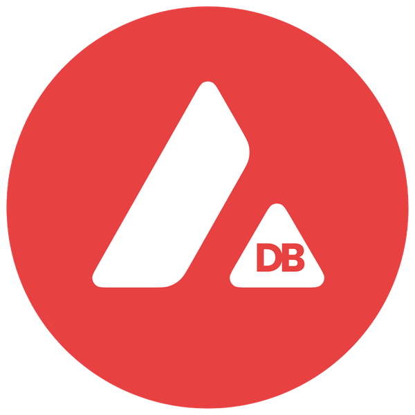

<div align="center">



# AvaDB

**Decentralized data infrastructure on Avalanche.**
Store and query data on community-run nodes and pay only for what you use.

[Live node](https://avadb.cloudycoding.com/docs) ·
[Pitch video & deck](https://drive.google.com/drive/folders/15E1Ow5TABuorpTL3c8FW3iJjr_fbmlKJ) ·
[Contract on Snowtrace](https://testnet.snowtrace.io/address/0x64Ba78d162A9aCdbC39BE273A86Fcd16ea47eE41)

</div>

---

## Why AvaDB

Storage, databases and AI infrastructure are concentrated in a handful of cloud
providers, sold through rigid subscriptions and oversized plans. AvaDB turns
spare capacity from the community into a shared storage and query layer:

- **Pay per use.** You pay for the bytes you store, the replicas you ask for and
  the time you keep the data, not for a monthly plan.
- **Community nodes.** Anyone can run a replicator node and serve data.
- **Verifiable.** Uploads, replica confirmations and access grants live
  on-chain; every node checks content hashes before storing anything.
- **Privacy-ready.** Uploaders are registered through the zero-knowledge
  identity layer of the eERC standard, and chunks can be private with
  per-address access grants.

## Live deployment (Avalanche Fuji)

| What                 | Where                                                                                                                           |
| -------------------- | ------------------------------------------------------------------------------------------------------------------------------- |
| Replicator node API  | https://avadb.cloudycoding.com (Swagger UI at [`/docs`](https://avadb.cloudycoding.com/docs), health at [`/status`](https://avadb.cloudycoding.com/status)) |
| AvaDBStorage         | [`0x64Ba78d162A9aCdbC39BE273A86Fcd16ea47eE41`](https://testnet.snowtrace.io/address/0x64Ba78d162A9aCdbC39BE273A86Fcd16ea47eE41) |
| Registrar            | [`0xbfe500B8978FA639A56E2e6557B177eE31B2e563`](https://testnet.snowtrace.io/address/0xbfe500B8978FA639A56E2e6557B177eE31B2e563) |
| RegistrationVerifier | [`0xDe8798a601f9e8CdFC696D532DDE54Af711D5BE8`](https://testnet.snowtrace.io/address/0xDe8798a601f9e8CdFC696D532DDE54Af711D5BE8) |

All three contracts are source-verified on Snowtrace.

## How it works

```
 User
  │  uploadChunk(bytes, requiredReplicas, isPrivate)
  ▼
AvaDBStorage.sol  ──── emits ChunkUploaded(chunkId, data, …)
  │                               │
  │  (only metadata in state)     │  (raw bytes in event logs — cheap)
  │                               ▼
  │                       Replicator nodes (avadb-node)
  │                          │  verify hash
  │                          │  store bytes in RocksDB
  │                          │  store metadata in Oracle Database
  │                          │  compute CID (sha256)
  │                          ▼
  │  confirmReplication(chunkId, cid, endpoint)
  ◄──────────────────────────┘
  │  (60 % of the required replicas confirmed)
  ▼
  emit ChunkCooled(chunkId, cid)
  │
  │  Hot → Cool: on-chain only the CID remains,
  │  the data lives in the replicator fleet
  ▼
 User queries the node API (/query, /chunk/:id/data)
```

1. **Cheap upload.** `uploadChunk` stores only metadata in contract state. The
   raw bytes travel in the `ChunkUploaded` event (about 8 gas per non-zero byte,
   against about 20,000 gas per 32-byte word of contract storage). The chunk id
   is `keccak256(data)`, and the uploader must be registered in the `Registrar`.
2. **Replication.** Replicator nodes read the event, verify that the bytes hash
   to the chunk id, persist them (RocksDB for the bytes, Oracle Database for the
   queryable metadata), compute a sha256 CID and call `confirmReplication`.
   Only replicators registered by the contract owner can confirm.
3. **Hot → Cool.** When the confirmations reach `replicationThreshold` (60 %
   by default) of `requiredReplicas`, the chunk turns *Cool* and
   `ChunkCooled` is emitted.
4. **Access.** Chunks can be private. The owner manages readers with
   `grantAccess` / `revokeAccess`; `requestData` and `isChunkAccessible` honour
   those grants.

## Repository layout

| Path                                | Contents                                                                                        |
| ----------------------------------- | ----------------------------------------------------------------------------------------------- |
| `contracts/avadb/AvaDBStorage.sol`  | Chunk upload, replication, hot/cool state and access control                                   |
| `contracts/avadb/AvaDB.sol`         | Encrypted record store (BabyJubJub ElGamal, same keys as eERC)                                  |
| `contracts/`                        | eERC privacy stack: `Registrar`, `EncryptedERC`, Groth16 verifiers                              |
| `avadb-node/`                       | Replicator node (NestJS): event listener, RocksDB + Oracle storage, query API                   |
| `scripts/deploy-avadb.ts`           | Deploys RegistrationVerifier → Registrar → AvaDBStorage                                         |
| `circom/`, `zk/`, `src/`            | eERC circuits, Go proving tooling and TypeScript crypto helpers                                 |
| `test/`                             | Hardhat tests (`AvaDB.ts` plus the eERC suites)                                                 |

## Getting started

### Contracts

Requirements: Node.js 22+. The Groth16 verifiers are already generated in
`contracts/verifiers/`, so Circom is only needed if you change the circuits.

```sh
git clone https://github.com/Emanuel250YT/AvaDB.git
cd AvaDB
npm install --ignore-scripts   # skip the circuit build in postinstall
npx patch-package
npx hardhat compile
```

Deploy to Fuji (Hardhat reads `PRIVATE_KEY` from `.env`):

```sh
echo "PRIVATE_KEY=0x..." > .env
npx hardhat run scripts/deploy-avadb.ts --network fuji
```

Networks available in `hardhat.config.ts`: `fuji`, `avalanche` and `avadb`
(the AvaDB L1, chain id `1152111412`).

### Replicator node

1. Start an Oracle Database (Oracle Free in Docker works out of the box):

   ```sh
   docker run -d --name avadb-oracle -p 1521:1521 \
     -e ORACLE_PASSWORD=change-me -e APP_USER=avadb -e APP_USER_PASSWORD=change-me \
     gvenzl/oracle-free:23-slim-faststart
   ```

2. Configure and run the node:

   ```sh
   cd avadb-node
   npm ci
   cp .env.example .env   # then edit it, see below
   npm run build
   npm run start:prod
   ```

   Key settings in `.env`:

   | Variable                   | Example                                             |
   | -------------------------- | --------------------------------------------------- |
   | `AVADB_RPC_URL`            | `https://avalanche-fuji-c-chain-rpc.publicnode.com` |
   | `AVADB_STORAGE_ADDRESS`    | `0x64Ba78d162A9aCdbC39BE273A86Fcd16ea47eE41`        |
   | `REGISTRAR_ADDRESS`        | `0xbfe500B8978FA639A56E2e6557B177eE31B2e563`        |
   | `START_BLOCK`              | `61006226` (AvaDBStorage deployment block on Fuji)  |
   | `REPLICATOR_PRIVATE_KEY`   | key of the node wallet                              |
   | `ORACLE_CONNECTION_STRING` | `localhost:1521/FREEPDB1`                           |
   | `NODE_ENDPOINT`            | public URL where this node serves data              |

   The node needs an RPC with `eth_newFilter` and wide `eth_getLogs` ranges.
   The official `api.avax-test.network` endpoint caps `eth_getLogs` at 100
   blocks and has no filters, so use a provider such as publicnode.

3. To confirm replicas on-chain, the contract owner must call
   `registerReplicator(<node wallet>)` and the node wallet needs AVAX for gas.

### Node API

| Method | Path                   | Description                                       |
| ------ | ---------------------- | ------------------------------------------------- |
| GET    | `/status`              | Health check, replicator address and latest block |
| POST   | `/query`               | JSON query over stored chunks                     |
| GET    | `/chunk/:chunkId/meta` | Chunk metadata                                    |
| GET    | `/chunk/:chunkId/data` | Raw bytes (`application/octet-stream`)            |
| GET    | `/docs`                | Swagger / OpenAPI UI                              |

```json
POST /query
{
  "filter": { "owner": "0xYourAddress", "state": 1, "isPrivate": false },
  "orderBy": "uploadedAt",
  "order": "desc",
  "limit": 20,
  "offset": 0
}
```

`orderBy` accepts `uploadedAt`, `confirmedReplicas` or `chunkId`.

## Tech stack

Solidity 0.8.27 · Hardhat · Circom / Groth16 (eERC) · NestJS · ethers v6 ·
RocksDB · Oracle Database · Docker · Avalanche C-Chain (Fuji)

## Roadmap

1. **Node MVP**: replicator node, storage contract, live on Fuji.
2. **SDK and public standard**: client SDK and a spec so others can build and extend nodes.
3. **Testnet and early birds**: open testnet with the first node operators and users.
4. **Mainnet and community**: production launch on a dedicated Avalanche L1 optimized for storage.

## Security notes

- Chunk bytes are emitted in event logs, which anyone can read. `isPrivate`
  controls who may request data through the protocol, so encrypt private data
  client-side before uploading it.
- The node's HTTP endpoints do not check `isChunkAccessible` yet; access control
  is enforced on-chain only.
- The audits in `audit/` cover the upstream eERC protocol, not the AvaDB
  contracts or the node.

## Built on eERC

AvaDB builds on the [Encrypted ERC-20 (eERC)](https://github.com/ava-labs/EncryptedERC)
protocol by Ava Labs / AvaCloud: the `Registrar`, the zero-knowledge circuits
and verifiers and the BabyJubJub tooling come from it. See the
[eERC documentation](https://docs.avacloud.io/encrypted-erc) for that part of
the stack.

## License

Distributed under the Ava Labs Ecosystem License; see [`LICENSE.md`](LICENSE.md).
